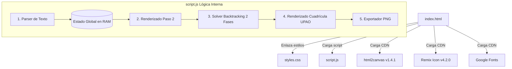

# INFORME TÉCNICO DE AUDITORÍA: ARMADOR DE HORARIOS INTELIGENTE

**Fecha de auditoría:** Octubre 2026  
**Auditor:** Ingeniero Senior Front-End / Full-Stack  
**Repositorio auditado:** `https://github.com/alessandrorr1007-debug/armador-horarios.git` (Rama: `main`)  
**Directorio local:** `d:\Proyectos\UPAO PROC\Horarios S`  

---

## 1. Resumen General

- **Tipo de aplicación:** Single Page Application (SPA) cliente pura (Vanilla HTML5 / CSS3 / JavaScript ES6+), sin dependencias de servidor ni frameworks frontend reactivos.
- **Propósito:** Herramienta interactiva orientada a estudiantes universitarios (específicamente calibrada para la Universidad Privada Antenor Orrego - UPAO). Permite al estudiante copiar el texto crudo de la oferta de asignaturas desde el portal académico (Banner), procesarlo mediante expresiones regulares para extraer cursos, secciones, NRCs, horarios, aulas, docentes, cupos y agrupaciones de ligas (teoría/práctica/laboratorio), gestionar restricciones (límite de créditos, materias obligatorias, exclusión de secciones sin cupo o no deseadas) y ejecutar un algoritmo de optimización combinatoria (Backtracking con ponderación multicriterio). El resultado se visualiza en una cuadrícula semanal proporcional a bloques horarios reales y puede descargarse como imagen PNG.
- **Estado general del proyecto:** **7.5 / 10**
  - *Justificación:* La lógica de negocio y el algoritmo combinatorio son robustos y resuelven un problema técnico real de alta fricción (resolución de ligas dependientes, minimización de huecos y reglas laborales personalizadas). El diseño visual es moderno, responsivo y cuenta con soporte nativo de tema oscuro y claro. No obstante, carece de arquitectura modular (código concentrado en dos archivos monolíticos), no cuenta con empaquetador o build tool (Vite, TypeScript), carece de persistencia local (`localStorage` ausente, lo que implica pérdida de datos al recargar), no dispone de tests automatizados para el algoritmo de resolución y tiene oportunidades de mejora en accesibilidad (a11y), rendimiento de carga inicial y seguridad en la inclusión de librerías externas vía CDN.

---

## 2. Stack y Tecnologías

| Capa / Herramienta | Tecnología detectada | Versión / Detalle |
| :--- | :--- | :--- |
| **Lenguaje de programación** | JavaScript (ES6+ Vanilla) | Estándar ECMAScript nativo en navegador |
| **Estructura y Maquetación** | HTML5 | Semántico (`<header>`, `<main>`, `<section>`, `<nav>`) |
| **Estilos y Diseño** | CSS3 nativo | Variables CSS (`:root`), Flexbox, CSS Grid, media queries |
| **Framework Frontend / CMS** | Ninguno | Vanilla JS directo sobre el DOM |
| **Librería de Exportación Gráfica** | `html2canvas` | `v1.4.1` (cargada vía CDN jsDelivr) |
| **Iconografía** | `Remix Icon` | `v4.2.0` (cargada vía CDN jsDelivr) |
| **Tipografía Web** | Google Fonts | `Outfit` (400-800) y `Plus Jakarta Sans` (400-700) |
| **Gestor de Paquetes** | Ninguno | No existe `package.json`, ni `npm`, `yarn` o `pnpm` |
| **Herramienta de Build / Bundler** | Ninguna | Sin Vite, Webpack, Rollup, PostCSS ni TypeScript |
| **Backend / APIs** | Ninguno | Ejecución 100% en el cliente (no hay endpoints ni servidores) |
| **Base de Datos / Persistencia** | Ninguna | En memoria RAM durante la sesión (variables JS en runtime) |

---

## 3. Estructura de Carpetas

Árbol de directorios del proyecto (hasta 3 niveles):

```text
d:\Proyectos\UPAO PROC\Horarios S\
├── .git/                      # Directorio de control de versiones Git local y ramas
├── .gitignore                 # Exclusiones de Git (node_modules, logs, OS files)
├── index.html                 # Estructura principal, marcado de los 3 pasos y modales
├── script.js                  # Lógica completa: parser, algoritmo combinatorio, eventos UI y exportación
├── styles.css                 # Sistema de diseño, tokens CSS, componentes y cuadrícula del horario
└── INFORME.md                 # Informe técnico de auditoría de arquitectura y código
```

*Nota:* No existen subdirectorios para assets (`/assets`, `/img`, `/fonts`), ni división modular para scripts (`/src`, `/components`, `/utils`). Todos los recursos residen en la raíz.

---

## 4. Páginas y Rutas

La aplicación no implementa enrutamiento por URL (no utiliza History API, rutas hash `#` ni librerías de routing). Funciona como un flujo guiado por pasos (Wizard) de página única controlado mediante la función `goToStep(stepNumber)` en `script.js` (L142-L154), alternando la visibilidad de tres secciones principales:

| Paso / Vista | ID del Contenedor | Archivo generador | Contenido y Funcionalidad |
| :--- | :--- | :--- | :--- |
| **Paso 1: Carga de Horarios** | `#step-1-section` | `index.html` (L74-L107) | Área de texto (`#text-input`) para pegar el texto copiado del portal académico; tarjeta de alertas (`#api-error-card`); indicador de cursos cargados; botón de procesamiento "Procesar y Agregar Curso". |
| **Paso 2: Verificación de Cursos y Cupos** | `#step-2-section` | `index.html` (L113-L156) / `script.js` (L363-L500) | Lista editable de tarjetas por curso (`#courses-editor-list`); control de cupos y secciones abiertas/cerradas; toggle de curso "Obligatorio" con ícono de candado; selector de límite de créditos deseados (`#credit-limit-input`); botón de vaciado de lista y botón para generar horario. |
| **Paso 3: Horario Optimizado y Calendario** | `#step-3-section` | `index.html` (L162-L270) / `script.js` (L966-L1176) | Resumen de créditos y materias excluidas; botón para activar/desactivar "Modo Optimización para Trabajo" (evita sábados y compacta huecos); selector de soluciones alternativas (píldoras de opción); tarjetas de métricas (horas semanales, huecos, eficiencia); cuadrícula visual semanal con bloques por materia; exportación a imagen PNG. |

---

## 5. Componentes y Archivos Clave

### Relación entre Archivos


### Detalle de Módulos Clave:
1. **Punto de Entrada (`index.html`):** Define el layout base: `header.app-header` (marca + botón de tema oscuro/claro), `nav.steps-tracker` (stepper interactivo) y los tres contenedores de paso `#step-1-section`, `#step-2-section` y `#step-3-section`.
2. **Motor de Parsing (`script.js` L163-L315):** `parseScheduleText(text)` analiza el texto crudo mediante expresiones regulares, detecta códigos de curso, NRC, capacidad (`CAPA`), matriculados (`REGI`), créditos (`CRED`), aulas, docentes, días y horas, agrupando secciones en ligas de teoría y práctica (`idLiga`, `tipoLiga`, `grupoLiga`).
3. **Motor Algorítmico (`script.js` L548-L814):** `solveSchedulesWithLigas(courses, creditLimit)` ejecuta un algoritmo de backtracking en 2 fases:
   - *Fase 1 (Obligatorios):* Encuentra combinaciones compatibles que garanticen todas las materias marcadas como obligatorias.
   - *Fase 2 (Opcionales y Créditos):* Añade materias opcionales respetando el presupuesto de créditos sin generar cruces horarios.
   - *Ponderación (`calculateSolutionMetrics`):* Penaliza tiempo muerto (huecos entre clases) con factor x100, días activos con factor x1000 y penaliza fuertemente (-500,000 pts) si hay clases en sábado antes de las 15:30 (Modo Trabajo).
4. **Renderizado de la Cuadrícula UPAO (`script.js` L966-L1176):** Mapea minutos absolutos (desde las 07:00 AM / min 420 hasta las 09:35 PM / min 1295) con una escala de `1.2 px/min` sobre una matriz fija de bloques académicos propios de la UPAO (`UPAO_ROW_BOUNDARIES`).
5. **Exportador Gráfico (`script.js` L1182-L1215):** Invoca `html2canvas` sobre `#timetable-wrapper` a escala 2x, adaptando el color de fondo al tema visual activo y descargando un archivo PNG con fecha ISO.

---

## 6. Estilos y Diseño

- **Metodología:** CSS nativo puro (`styles.css`, 1051 líneas) organizado por secciones funcionales. No usa frameworks (ni Tailwind, ni Bootstrap) ni preprocesadores.
- **Tokens de Diseño y Variables CSS (`:root` y `[data-theme="light"]`):**
  - **Tipografía:** `--font-primary: 'Plus Jakarta Sans'` para textos de cuerpo y formularios; `--font-heading: 'Outfit'` para títulos, cifras numéricas e indicadores.
  - **Paleta de Colores (Dark por defecto):** Fondo principal `#0b0f19`, tarjetas `#131b2e`, inputs `#1d283d`, bordes `rgba(255, 255, 255, 0.1)`, texto principal `#f3f4f6`, texto atenuado `#9ca3af`.
  - **Colores de Acento y Estado:** Primario `#6366f1` (Indigo), acento `#8b5cf6` (Púrpura), éxito `#10b981` (Verde esmeralda), advertencia `#f59e0b` (Ámbar), peligro `#ef4444` (Rojo).
  - **Paleta Light:** Fondo `#f8fafc`, tarjetas `#ffffff`, bordes `#e2e8f0`, texto `#0f172a`.
  - **Colores de Eventos en Calendario (`script.js` L28-L37):** 8 tonos predefinidos de alto contraste (Indigo, Esmeralda, Ámbar, Púrpura, Cian, Rojo, Naranja, Rosa) con texto blanco para garantizar legibilidad en los bloques de clase.
- **Diseño Adaptativo (Responsive):**
  - Regla `@media (max-width: 768px)`: Reorganiza los encabezados y toolbars en disposición vertical (`column`), oculta los rótulos de texto en el stepper conservando los números de paso, y adapta las barras de optimización.
  - La cuadrícula de horarios mantiene un contenedor con desplazamiento horizontal (`overflow-x: auto; min-width: 900px`), lo que previene que las columnas de los 7 días se colapsen o pierdan legibilidad en pantallas pequeñas.

---

## 7. Contenido y Datos

- **Fuente de Datos:** No se consumen APIs externas, endpoints REST ni bases de datos. El 100% de la información proviene de la entrada directa del usuario vía portapapeles en el Paso 1.
- **Mapeo de Datos:** El parser procesa cadenas de texto con patrones específicos del portal banner UPAO:
  - Detección de días mediante alias (`LUN`, `MAR`, `MIE`, `MIERCOLES`, `JUE`, `VIE`, `SAB`, `DOM`).
  - Detección de rangos horarios en formato 12 horas con indicador meridiano (`HH:MM AM - HH:MM PM`).
  - Detección de identificadores de liga (`Grupo: XX ➔ YY`, `ID LIGA: T1`, etc.).
- **Formularios y Envío:** No se utilizan elementos `<form>` nativos ni envíos HTTP (POST/GET). La captura y validación se realiza mediante escuchadores de eventos en botones (`#btn-process-input`, `#btn-generate-schedule`). Los datos se procesan estrictamente en la memoria local de la pestaña.

---

## 8. Assets

- **Imágenes:** No existen archivos de imagen locales (`.png`, `.jpg`, `.svg`).
- **Favicon:** Definido como un Data URI SVG embebido en el HTML (`index.html` L10):
  ```html
  <link rel="icon" type="image/svg+xml" href="data:image/svg+xml,<svg xmlns='http://www.w3.org/2000/svg' viewBox='0 0 100 100'><text y='.9em' font-size='90'>📅</text></svg>">
  ```
- **Fuentes:** Descargadas vía Google Fonts CDN (`Outfit` y `Plus Jakarta Sans`).
- **Iconografía:** Paquete de fuentes web Remix Icon `v4.2.0` cargado vía CDN.
- **Pesos de Archivos Locales en Disco:**
  - `index.html`: **11.6 KB** (277 líneas)
  - `styles.css`: **19.9 KB** (1,051 líneas)
  - `script.js`: **49.5 KB** (1,250 líneas)
  - `.gitignore`: **89 bytes**
  - **Peso total del código estático:** **~81 KB** (extremadamente ligero).
- **Archivos sin usar:** No se detectaron archivos huérfanos o sin referencia en el repositorio.

---

## 9. Configuración y Despliegue

- **Variables de Entorno:** Ninguna (`.env` no existe ni es requerido al no haber backend ni credenciales).
- **Scripts de Automatización:** Inexistentes (sin `package.json`).
- **Hosting / Infraestructura:** 
  - La aplicación es un sitio estático puro. Puede ser alojada en cualquier proveedor de hosting estático (GitHub Pages, Cloudflare Pages, Netlify, Vercel, Firebase Hosting o servidores Nginx/Apache) sin necesidad de runtime Node.js.
  - Repositorio remoto configurado: `https://github.com/alessandrorr1007-debug/armador-horarios.git` en rama `main`.
- **Integración Continua / Despliegue Continuo (CI/CD):** No se detectan pipelines ni configuraciones de GitHub Actions (`.github/workflows`).

---

## 10. SEO y Analítica

- **Aspectos Implementados:**
  - `lang="es"` en etiqueta `<html>`.
  - Título optimizado: `<title>Armador de Horarios Inteligente | Generador Profesional de Horarios</title>`.
  - Meta descripción: `<meta name="description" content="Plataforma profesional para generar la mejor combinación de horarios universitarios sin cruces de clases.">`.
  - Viewport móvil: `<meta name="viewport" content="width=device-width, initial-scale=1.0">`.
  - Favicon vectorial en SVG.
- **Carencias Técnicas Detectadas:**
  - Ausencia de etiquetas Open Graph (`og:title`, `og:description`, `og:image`, `og:url`) para previsualización en WhatsApp, Telegram o redes sociales.
  - Ausencia de Twitter Card meta tags.
  - Ausencia de archivo `robots.txt` y `sitemap.xml`.
  - Ausencia de datos estructurados en formato JSON-LD (`schema.org/WebApplication`).
  - No cuenta con herramientas de analítica web (Google Analytics, Plausible, etc.) ni etiquetas de seguimiento.

---

## 11. Rendimiento y Accesibilidad (a11y)

### Rendimiento
- **Fortalezas:** Carga inicial casi instantánea (< 100 KB de código fuente total). No hay dependencias pesadas de frameworks (React/Angular/Vue).
- **Cuellos de Botella:**
  - `html2canvas` (`index.html` L21) se carga de forma síncrona en el `<head>` sin atributo `defer` ni `async`, bloqueando el renderizado inicial del DOM a pesar de que esta librería solo se usa al final del flujo en el Paso 3.
  - Dependencia de 2 hojas de estilo externas alojadas en CDN (Google Fonts y Remix Icon) que introducen latencia de red inicial y saltos tipográficos (FOUT/FOIT) sin directiva `font-display: swap` explícita para Remix Icon.

### Accesibilidad (a11y)
- **Fortalezas:** Uso de etiquetas semánticas (`<header>`, `<main>`, `<section>`, `<nav>`), `aria-label="Cambiar tema"` en `#theme-toggle`, `aria-label="Pasos de la aplicación"` y `aria-current="step"` en el stepper.
- **Deficiencias:**
  - El `<textarea id="text-input">` (`index.html` L91) no cuenta con una etiqueta `<label for="text-input">` asociada, dependiendo únicamente del atributo `placeholder`.
  - Los campos de texto generados dinámicamente (`.course-title-input`, `script.js` L380) carecen de `aria-label` o `<label>`.
  - Los botones de eliminación rápida (`.btn-del-sec`, `script.js` L458) contienen solo el ícono `<i class="ri-close-line"></i>` sin `aria-label`, resultando inaccesibles para lectores de pantalla.
  - El contraste de color en tema oscuro para el texto secundario (`--text-muted: #9ca3af` sobre `--bg-input: #1d283d`) produce una relación de contraste aproximada de ~4.2:1, situándose por debajo del estándar recomendado WCAG AA (4.5:1) para texto pequeño de 12px-13px.

---

## 12. Seguridad

- **Credenciales y Secretos:** **Limpio.** No se encontraron claves privadas, tokens de API, contraseñas ni cadenas sensibles en el código.
- **Integridad de Recursos Externos (Subresource Integrity - SRI):** 
  - `html2canvas` y `remixicon.css` se descargan desde `cdn.jsdelivr.net` sin los atributos `integrity="sha384-..."` ni `crossorigin="anonymous"`. Si el CDN sufriera un ataque de envenenamiento de caché o manipulación en tránsito, la aplicación ejecutaría scripts de terceros no verificados.
- **Manejo de XSS (Cross-Site Scripting):**
  - El autor incluyó una función utilitaria `escapeHtml(str)` (`script.js` L1242-L1247) que reemplaza `&`, `<`, `>`, `"`, `'`.
  - No obstante, la interfaz se construye masivamente interpolando variables en cadenas mediante `.innerHTML` (`script.js` L377, L449, L1062, L1163). Aunque `escapeHtml` mitiga el riesgo en campos de texto, este patrón es propenso a errores humanos si una nueva propiedad no se sanitiza explícitamente antes de insertarse en el DOM.

---

## 13. Calidad del Código y Deuda Técnica

1. **Monolito de Código:** Todo el comportamiento de la aplicación reside en un único archivo de 1,250 líneas (`script.js`) dentro de un único bloque `DOMContentLoaded`. No hay separación de responsabilidades entre el parser, el solver algorítmico, el renderizador y los manejadores de eventos.
2. **Volatilidad del Estado (Falta de `localStorage`):** El estado `coursesData` se mantiene en una variable de memoria. Si el estudiante recarga la página por accidente tras pegar 8 cursos con múltiples secciones, pierde todo su trabajo.
3. **Ausencia de Pruebas Unitarias (Tests):** El algoritmo de resolución combinatoria por backtracking (`solveSchedulesWithLigas`) y el parser regex son piezas críticas y propensas a errores de regresión ante cambios de formato en el texto copiado de la universidad. No existe ningún test automatizado (e.g. Vitest/Jest).
4. **Acoplamiento Fuerte y Valores Mágicos (Hardcoding):**
   - La cuadrícula contiene bloques fijos propios de la UPAO (`UPAO_ROW_BOUNDARIES`, `script.js` L1076-L1085: 07:00 a 08:50, 08:50 a 10:40, etc.).
   - La regla del "Modo Optimización para Trabajo" (`script.js` L889: `slot.day === 5 && slot.startMin < 930`) codifica en duro el sábado antes de las 15:30 (03:30 PM) como conflicto laboral, sin permitir al usuario parametrizar sus propios horarios libres o laborales.
5. **Generador de IDs Inseguro / No Determinista:** Se utiliza `Math.random().toString(36).substring(2, 7)` para generar identificadores de sección (`sectionId`) en caso de que falten en el texto (`script.js` L288 y L576), lo que puede producir colisiones en lotes extensos.

---

## 14. Problemas Priorizados

### Críticos (Alto Impacto)
1. **Pérdida inmediata de datos ante recarga (`script.js`, L8):**  
   *Archivo:* [script.js](file:///d:/Proyectos/UPAO%20PROC/Horarios%20S/script.js#L8)  
   *Detalle:* El array `coursesData` reside en la memoria RAM del navegador. Si el usuario presiona F5 o cierra la pestaña, pierde todos los cursos cargados y configurados. Debe persistirse en `localStorage`.
2. **Carga de scripts y estilos externos sin verificación de integridad (SRI) (`index.html`, L18 y L21):**  
   *Archivo:* [index.html](file:///d:/Proyectos/UPAO%20PROC/Horarios%20S/index.html#L18-L21)  
   *Detalle:* Tanto Remix Icon como html2canvas se obtienen de un CDN público sin hashes `integrity`, exponiendo la aplicación a manipulación de scripts de terceros.

### Importantes (Medio Impacto)
3. **Script externo bloqueante de renderizado en el `<head>` (`index.html`, L21):**  
   *Archivo:* [index.html](file:///d:/Proyectos/UPAO%20PROC/Horarios%20S/index.html#L21)  
   *Detalle:* `html2canvas.min.js` bloquea el parseo del HTML inicial. Debe cargarse con `defer` o importarse dinámicamente solo cuando el usuario pulse el botón de exportación PNG.
4. **Construcción masiva del DOM mediante `.innerHTML` (`script.js`, L377-L396, L449-L475, L1163-L1167):**  
   *Archivo:* [script.js](file:///d:/Proyectos/UPAO%20PROC/Horarios%20S/script.js#L377-L396)  
   *Detalle:* Inyectar plantillas de texto mediante `.innerHTML` es una práctica insegura y menos eficiente que el uso de `document.createElement`, `template` tags o manipulación directa de propiedades DOM (`textContent`).
5. **Falta de modularidad y arquitectura escalable (`script.js` y `styles.css`):**  
   *Archivos:* [script.js](file:///d:/Proyectos/UPAO%20PROC/Horarios%20S/script.js#L1-L1250) y [styles.css](file:///d:/Proyectos/UPAO%20PROC/Horarios%20S/styles.css#L1-L1051)  
   *Detalle:* 1,250 líneas de JS y 1,051 líneas de CSS en archivos únicos sin TypeScript ni módulos ES6 (`import`/`export`), impidiendo el mantenimiento limpio del código a mediano plazo.
6. **Ausencia de tests unitarios sobre el solver y parser:**  
   *Archivos:* [script.js](file:///d:/Proyectos/UPAO%20PROC/Horarios%20S/script.js#L163-L315) y [script.js](file:///d:/Proyectos/UPAO%20PROC/Horarios%20S/script.js#L548-L814)  
   *Detalle:* El motor de backtracking combinatorio y el parser de expresiones regulares carecen de pruebas automatizadas que garanticen su precisión.

### Menores (Bajo Impacto / Mejoras Técnicas)
7. **Falta de accesibilidad en inputs y botones de acción rápida:**  
   *Archivos:* [index.html](file:///d:/Proyectos/UPAO%20PROC/Horarios%20S/index.html#L91), [script.js](file:///d:/Proyectos/UPAO%20PROC/Horarios%20S/script.js#L380) y [script.js](file:///d:/Proyectos/UPAO%20PROC/Horarios%20S/script.js#L458)  
   *Detalle:* El `textarea` carece de etiqueta `<label>`, y los botones de eliminar sección carecen de atributo `aria-label`.
8. **Parámetros institucionales y laborales hardcodeados:**  
   *Archivo:* [script.js](file:///d:/Proyectos/UPAO%20PROC/Horarios%20S/script.js#L889) y [script.js](file:///d:/Proyectos/UPAO%20PROC/Horarios%20S/script.js#L1076-L1085)  
   *Detalle:* Horarios rígidos UPAO y restricción de sábados a las 15:30 fijados en el código fuente en lugar de ser configurables por el usuario.
9. **Carencia de meta tags Open Graph y SEO enriquecido:**  
   *Archivo:* [index.html](file:///d:/Proyectos/UPAO%20PROC/Horarios%20S/index.html#L1-L25)  
   *Detalle:* No hay soporte para tarjetas sociales en plataformas de mensajería ni datos estructurados.
10. **Generación de IDs con `Math.random()`:**  
    *Archivo:* [script.js](file:///d:/Proyectos/UPAO%20PROC/Horarios%20S/script.js#L288) y [script.js](file:///d:/Proyectos/UPAO%20PROC/Horarios%20S/script.js#L576)  
    *Detalle:* Se recomienda usar `crypto.randomUUID()` nativo del navegador.

---

## 15. Lo que Está Bien Hecho y Conviene Conservar

1. **Resolución del Problema de Negocio (Ligas Universitarias):** El tratamiento de las dependencias entre teoría, práctica y laboratorio (`grupoLiga` y `tipoLiga`) es sobresaliente. Muchos generadores de horarios fallan al armar materias compuestas; este motor agrupa correctamente las secciones ligadas antes de combinarlas.
2. **Solver en 2 Fases con Backtracking Multicriterio:** La separación entre cursos obligatorios (fase fija) y cursos opcionales con presupuesto de créditos (fase de relleno) es una solución algorítmica muy inteligente para evitar sobrepasar límites crediticios sin sacrificar materias troncales.
3. **Métricas de Calidad de Horario:** El cálculo del tiempo muerto total (huecos entre clases), número de días lectivos e índice de compactación ofrece valor real inmediato al estudiante para tomar decisiones.
4. **Diseño Visual Pulido y Tema Oscuro/Claro:** La interfaz gráfica es estética, moderna y utiliza tokens CSS claros mediante Custom Properties, con transiciones suaves y estados de foco bien definidos.
5. **Cálculo de Grilla por Minutos Absolutos (`PX_PER_MIN`):** El posicionamiento de los bloques en el calendario (`script.js` L1153: `topPx` y `heightPx`) calcula el píxel exacto según los minutos de inicio y fin, evitando desfases visuales comunes en tablas HTML estáticas.
6. **Autonomía y Privacidad:** Al no enviar datos a ningún servidor externo, el estudiante tiene la garantía de que sus datos académicos no se almacenan ni comparten.

---

## 16. Preguntas Pendientes para Definir Mejoras

Para avanzar hacia una refactorización o evolución del proyecto, se plantean las siguientes preguntas:

1. **Persistencia de Datos:** ¿Deseas que implementemos persistencia automática en `localStorage` (para que los cursos se guíen entre sesiones y se pueda recuperar el horario con un botón de "Restaurar sesión anterior")?
2. **Flexibilidad de Restricciones (Modo Trabajo / Horarios Libres):** El modo laboral actual bloquea específicamente sábados antes de las 3:30 PM. ¿Te gustaría que el usuario pueda definir libremente sus propios bloques de indisponibilidad (por ejemplo: "No puedo Lunes y Miércoles por la mañana" o "Trabajo de Lunes a Viernes de 8 a 1")?
3. **Modularización y Build System:** ¿Prefieres mantener el proyecto en Vanilla JS puro de cero dependencias (sin `package.json`), o te interesaría migrar a un entorno moderno con **Vite + TypeScript + ESLint** que permita dividir el código en módulos (`parser.ts`, `solver.ts`, `grid.ts`, `storage.ts`) y agregar tests automáticos con Vitest?
4. **Soporte Multi-Universidad:** La cuadrícula actual tiene hardcodeados los bloques horarios específicos de la UPAO (`07:00 - 08:50`, `08:50 - 10:40`, etc.). ¿El objetivo es mantener la herramienta exclusivamente para UPAO, o hacer que la grilla horaria sea dinámica (e.g. bloques estándar de 1 hora) para que funcione con cualquier universidad?
5. **Funcionalidades de Exportación Adicionales:** Además de exportar como PNG, ¿sería de utilidad incorporar exportación a **Google Calendar / Outlook (.ics)** para que los estudiantes sincronicen las clases directamente con su teléfono móvil?
